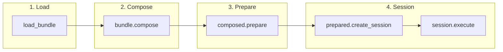
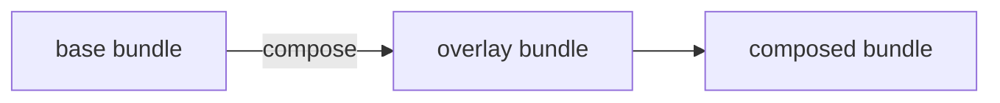
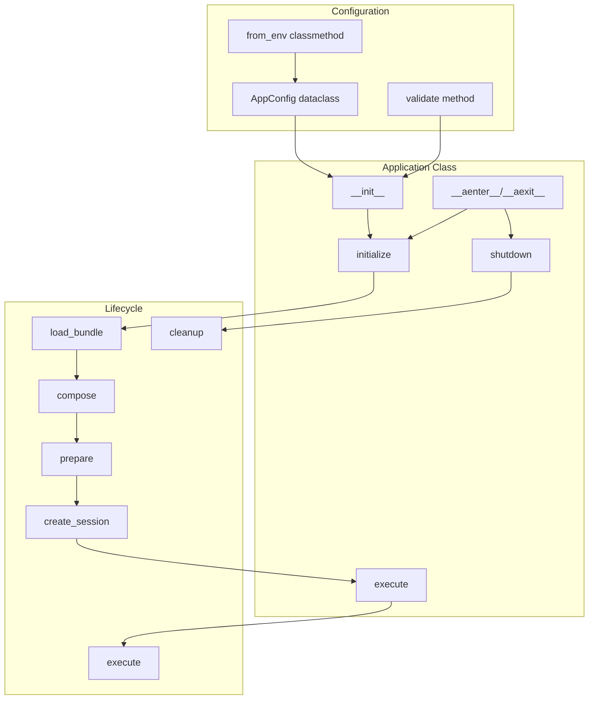
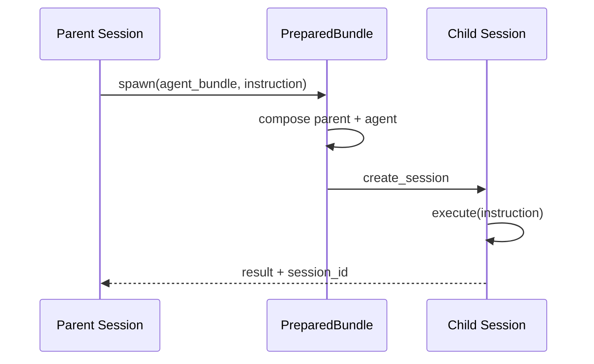
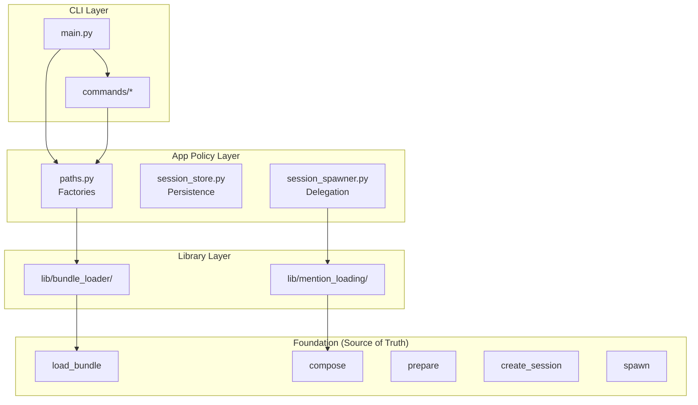

# Architecture Reference

This document describes the **amplifier-foundation architecture** - the source of truth for building Amplifier applications. It also includes reference material about `amplifier-app-cli` as one implementation example.

---

## How to Use This Document

- **Building a new app?** Start with [Foundation Architecture](#foundation-architecture)
- **Understanding bundles?** See [Bundle System](#bundle-system)
- **Studying app-cli?** See [Reference: amplifier-app-cli](#reference-amplifier-app-cli-implementation) (learn from it, don't copy its patterns)

---

## Foundation Architecture

### Core Workflow

Every Amplifier application follows this fundamental pattern:

```
load_bundle() → compose() → prepare() → create_session() → execute()
```



### Code Example

```python
from amplifier_foundation import load_bundle

async def main():
    # 1. Load bundles
    foundation = await load_bundle("git+https://github.com/microsoft/amplifier-foundation@main")
    provider = await load_bundle("./providers/anthropic.yaml")

    # 2. Compose (later overrides earlier)
    composed = foundation.compose(provider)

    # 3. Prepare (downloads modules)
    prepared = await composed.prepare()

    # 4. Create session and execute
    async with await prepared.create_session() as session:
        response = await session.execute("Hello!")
        print(response)
```

### Philosophy

| Principle | Description |
|-----------|-------------|
| **Mechanism, Not Policy** | Foundation provides loading/composition. Apps decide which bundles to use. |
| **Ruthless Simplicity** | One concept (bundle), one mechanism (`compose()`). |
| **Text-First** | YAML/Markdown formats are human-readable, diffable, versionable. |
| **Composable** | Small bundles compose into larger configurations. |

---

## Bundle System

### What is a Bundle?

A **Bundle** is a composable configuration unit that produces a **mount plan** for sessions.

```
Bundle → compose() → prepare() → Mount Plan → AmplifierSession
```

### Bundle Format

Bundles are markdown files with YAML frontmatter:

```markdown
---
bundle:
  name: my-app
  version: 1.0.0

session:
  orchestrator: {module: loop-streaming}
  context: {module: context-simple}

providers:
  - module: provider-anthropic
    source: git+https://github.com/microsoft/amplifier-module-provider-anthropic@main
    config:
      default_model: claude-sonnet-4-5

tools:
  - module: tool-filesystem
    source: git+https://github.com/microsoft/amplifier-module-tool-filesystem@main
---

You are a helpful assistant.
```

### Bundle Sections

| Section | Purpose |
|---------|---------|
| `bundle` | Metadata (name, version) |
| `session` | Orchestrator and context manager |
| `providers` | LLM backends |
| `tools` | Agent capabilities |
| `hooks` | Observability and control |
| `agents` | Named agent configurations |
| `context` | Context files to include |
| `instruction` | System instruction (markdown body) |

### Bundle Composition

Bundles compose with later overriding earlier:

```python
result = base.compose(overlay)  # overlay wins on conflicts
```



### Merge Rules

| Section | Rule |
|---------|------|
| `session` | Deep merge (nested dicts merged) |
| `providers` | Merge by module ID |
| `tools` | Merge by module ID |
| `hooks` | Merge by module ID |
| `instruction` | Replace (later wins) |

### Bundle Includes

Bundles can declare dependencies:

```yaml
bundle:
  name: dev
includes:
  - ./base.md
  - git+https://github.com/microsoft/amplifier-foundation@main
```

Includes are resolved and composed automatically.

---

## Application Architecture Pattern

### Blueprint (from foundation examples/08_cli_application.py)

```python
import asyncio
from dataclasses import dataclass
from amplifier_foundation import Bundle, load_bundle


@dataclass
class AppConfig:
    """Configuration loaded from environment/files."""
    provider_bundle: str = "anthropic.yaml"
    api_key: str | None = None

    @classmethod
    def from_env(cls) -> "AppConfig":
        import os
        return cls(
            provider_bundle=os.getenv("PROVIDER", "anthropic.yaml"),
            api_key=os.getenv("ANTHROPIC_API_KEY"),
        )

    def validate(self) -> None:
        if not self.api_key:
            raise ValueError("ANTHROPIC_API_KEY not set")


class AmplifierApp:
    """Application class following foundation pattern."""

    def __init__(self, config: AppConfig):
        self.config = config
        self.session = None

    async def initialize(self) -> None:
        """Load, compose, prepare, create session."""
        # Load bundles
        foundation = await load_bundle("git+https://github.com/microsoft/amplifier-foundation@main")
        provider = await load_bundle(f"./providers/{self.config.provider_bundle}")

        # Compose
        composed = foundation.compose(provider)

        # Prepare
        prepared = await composed.prepare()

        # Create session
        self.session = await prepared.create_session()

    async def execute(self, prompt: str) -> str:
        """Execute a prompt."""
        if not self.session:
            raise RuntimeError("Not initialized")
        return await self.session.execute(prompt)

    async def shutdown(self) -> None:
        """Clean up resources."""
        if self.session:
            await self.session.cleanup()

    async def __aenter__(self):
        await self.initialize()
        return self

    async def __aexit__(self, *args):
        await self.shutdown()


async def main():
    config = AppConfig.from_env()
    config.validate()

    async with AmplifierApp(config) as app:
        response = await app.execute("Hello!")
        print(response)


if __name__ == "__main__":
    asyncio.run(main())
```

### Key Patterns



---

## Agent Delegation

### Defining Agents as Bundles

Agents are bundles with agent-specific configuration:

```markdown
---
agent:
  name: bug-hunter
  description: Expert at finding and fixing bugs

providers:
  - module: provider-anthropic
    config:
      default_model: claude-sonnet-4-5
      temperature: 0.3
---

You are an expert bug hunter. Systematically analyze code for bugs.
```

### Spawning Agents

```python
# Load agent as bundle
agent_bundle = await load_bundle("./agents/bug-hunter.md")

# Spawn sub-session
result = await prepared.spawn(
    child_bundle=agent_bundle,
    instruction="Find bugs in auth.py",
    compose=True,            # Compose with parent (default)
    parent_session=session,  # Inherit UX
)

print(result["output"])
```



---

## @Mention System

### Syntax

Reference context files using `@namespace:path`:

```markdown
See @foundation:context/guidelines.md for guidelines.
```

### How It Works

1. During composition, each bundle's `base_path` is tracked by namespace
2. PreparedBundle resolves `@namespace:path` references
3. Content is loaded and included inline

### Common Namespaces

| Namespace | Source |
|-----------|--------|
| `@foundation:` | amplifier-foundation bundle |
| `@{bundle-name}:` | Any composed bundle |

---

## Reference: amplifier-app-cli Implementation

> **Note:** This section documents how `amplifier-app-cli` implements app-layer policy. Learn from it to understand one approach, but use foundation patterns when building your own applications.

### What amplifier-app-cli Adds

The CLI implements **policy** on top of foundation **mechanisms**:

| Foundation (Mechanism) | App-CLI (Policy) |
|----------------------|------------------|
| `load_bundle()` | Bundle search paths, well-known bundles |
| `compose()` | Three-scope config merging |
| `create_session()` | SessionStore for persistence |
| `spawn()` | session_spawner with project-scoped storage |
| `@namespace:path` | `@user:`, `@project:`, `@~/` shortcuts |

### App-CLI Architecture (For Reference)



### Key App-CLI Files (Reference Only)

| File | Purpose | Foundation Equivalent |
|------|---------|----------------------|
| `session_store.py` | Session persistence | Session lifecycle via `create_session()` |
| `session_spawner.py` | Agent delegation | `prepared.spawn()` |
| `paths.py` | Config factories | `load_bundle()` with paths |
| `lib/bundle_loader/` | Bundle discovery | `load_bundle()` |
| `lib/mention_loading/` | Mention resolution | Foundation's `@namespace:path` |

### Why Not Copy App-CLI Patterns?

The app-cli patterns are **policy decisions** specific to that CLI:
- Three-scope config (local/project/global) - not universal
- Project-scoped session storage - specific to multi-project CLI
- Custom mention shortcuts (`@user:`, `@project:`) - CLI-specific

When building your own app:
1. Start with foundation patterns (load → compose → prepare → execute)
2. Add your own policy decisions
3. Don't assume app-cli's decisions are correct for your use case

---

## Foundation API Reference

### Bundle Loading

```python
from amplifier_foundation import load_bundle, Bundle

# Load from file
bundle = await load_bundle("./my-bundle.md")

# Load from git
bundle = await load_bundle("git+https://github.com/org/repo@main")

# Load from subdirectory
bundle = await load_bundle("git+https://github.com/org/repo@main#subdirectory=bundles/dev")

# Create programmatically
bundle = Bundle(
    name="my-bundle",
    version="1.0.0",
    providers=[{"module": "provider-anthropic", "source": "..."}],
)
```

### Composition

```python
# Two bundles
composed = base.compose(overlay)

# Multiple bundles
composed = base.compose(overlay1).compose(overlay2)

# Varargs
composed = base.compose(overlay1, overlay2)
```

### Preparation

```python
# Prepare downloads modules
prepared = await composed.prepare()

# PreparedBundle is ready for session creation
session = await prepared.create_session()
```

### Session Lifecycle

```python
# Context manager (recommended)
async with await prepared.create_session() as session:
    response = await session.execute("Hello!")

# Manual (must call cleanup)
session = await prepared.create_session()
try:
    response = await session.execute("Hello!")
finally:
    await session.cleanup()
```

### Agent Spawning

```python
# Load agent bundle
agent = await load_bundle("./agents/my-agent.md")

# Spawn sub-session
result = await prepared.spawn(
    child_bundle=agent,
    instruction="Do the task",
    compose=True,
    parent_session=session,
    session_id=None,  # or provide ID to resume
)

# Result contains output and session_id
print(result["output"])
print(result["session_id"])  # for resumption
```

---

## Key Foundation Files

| File | Purpose |
|------|---------|
| `README.md` | Quick start and overview |
| `docs/CONCEPTS.md` | Mental model |
| `docs/PATTERNS.md` | Common patterns |
| `examples/08_cli_application.py` | CLI blueprint |
| `bundle.md` | Main foundation bundle |
| `providers/` | Provider configurations |
| `agents/` | Reusable agents |

---

## Summary: What to Use

| If you need to... | Use this... |
|------------------|-------------|
| Load a bundle | `await load_bundle(path_or_url)` |
| Combine configurations | `base.compose(overlay)` |
| Prepare for execution | `await composed.prepare()` |
| Create a session | `await prepared.create_session()` |
| Execute a prompt | `await session.execute(prompt)` |
| Delegate to agent | `await prepared.spawn(agent_bundle, instruction)` |
| Clean up | `await session.cleanup()` or context manager |

**Remember:** Foundation provides the mechanism. Your app provides the policy.
