# Amplifier Architecture & Flow Documentation

> **Comprehensive developer guide to understanding Amplifier application architecture**
> This document traces the entire application from startup to execution, with detailed Mermaid diagrams for both technical and non-technical audiences.

> **Note:** This documentation is based on [amplifier-simplecli](https://github.com/michaeljabbour/amplifier-simplecli), the reference implementation for this skill. The patterns shown here apply to any Amplifier CLI application.

---

## Table of Contents

1. [High-Level Overview](#high-level-overview)
2. [Architecture Layers](#architecture-layers)
3. [Application Startup Flow](#application-startup-flow)
4. [Bundle System Deep Dive](#bundle-system-deep-dive)
5. [Session Management](#session-management)
6. [Module System](#module-system)
7. [Execution Flow](#execution-flow)
8. [Hook System](#hook-system)
9. [Complete End-to-End Flow](#complete-end-to-end-flow)
10. [Key Design Principles](#key-design-principles)

---

## High-Level Overview

### What is SimpleCLI?

SimpleCLI is an **interactive command-line interface** for conversing with AI models (like Claude). Think of it as a sophisticated chat application that runs in your terminal, with powerful features like:

- 🔧 **Tool execution**: The AI can read files, run commands, search the web
- 📦 **Modular architecture**: Easy to add new capabilities (tools, hooks, providers)
- 🎨 **Composable bundles**: Mix and match different configurations like building blocks
- 💾 **Session management**: Resume previous conversations
- 🔒 **Safety features**: Approval gates for dangerous operations, automatic backups

### Three-Layer Architecture

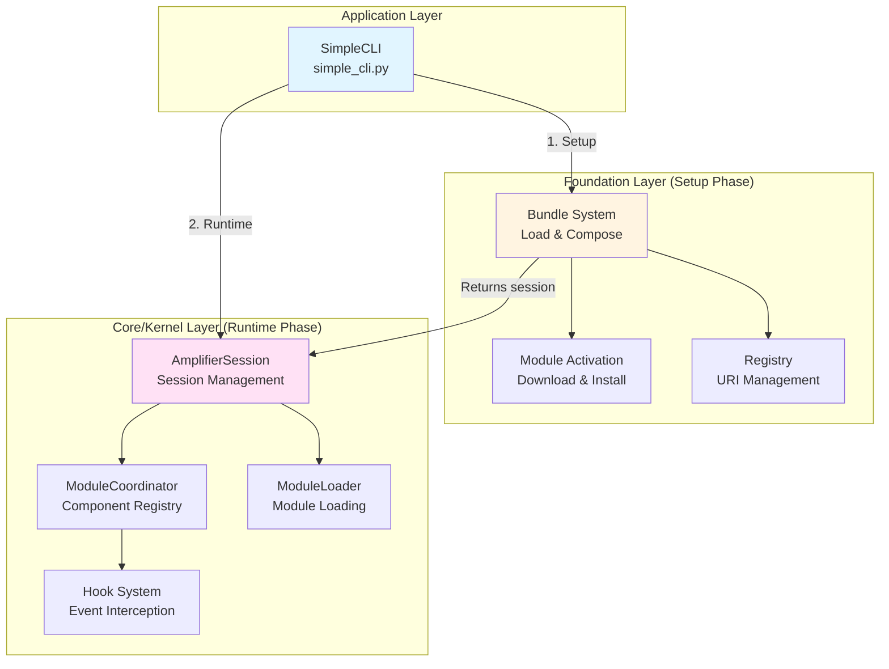

**Flow:**
1. **Setup Phase**: SimpleCLI calls Foundation (`load_bundle`, `compose`, `prepare`)
2. **Handoff**: Foundation returns configured Core session
3. **Runtime Phase**: SimpleCLI calls Core directly (`session.execute`)

**For non-technical readers**: Think of this like building and driving a car:
- **Application (Driver)**: You control everything
- **Foundation (Factory)**: Builds and configures the car *once at startup*
- **Core (Engine)**: You drive directly - the factory isn't involved during runtime

**Key Insight**: Foundation is used only during setup. After `prepared.create_session()`, SimpleCLI calls Core directly for all execution.

---

## Architecture Layers

### Layer 1: Application Layer (simple_cli.py)

**What it does**: This is the entry point - the code that runs when you type `python simple_cli.py`.

**Key responsibilities**:
- Parse command-line arguments (`--init`, `--update`, `--modules`)
- Load user settings from `~/.amplifier-cli/settings.yaml`
- Present the interactive terminal UI
- Handle user input and display responses

**Main components**:
- `run_cli()`: The main interactive loop
- `run_init()`: Initial setup wizard
- `run_update()`: Update manager for modules
- `list_sessions()`: Session history browser

### Layer 2: Foundation Layer (amplifier-foundation)

**What it does**: This is the "factory" that builds and configures Core sessions. **Foundation only runs during setup** - after session creation, it's not involved in execution.

**Key concepts**:

**Bundle**: A composable unit containing:
- Configuration (what modules to use)
- Instructions (system prompts)
- Resources (context files, agent definitions)

Think of bundles like LEGO sets - you can combine multiple bundles to create the final configuration.

**Key responsibilities** (setup phase only):
- Load bundle files (`.md` files with YAML frontmatter)
- Compose multiple bundles together
- Download and install modules from GitHub
- Resolve file paths and URIs
- Cache downloaded modules
- **Create and return configured Core sessions**

**Main components**:
- `Bundle`: The core composable unit
- `BundleRegistry`: Manages bundle URIs and caching
- `ModuleActivator`: Downloads and installs modules
- `SimpleSourceResolver`: Resolves URIs to local paths

**Critical**: Foundation's job ends after `prepared.create_session()` returns. All execution calls go directly to Core.

### Layer 3: Core/Kernel Layer (amplifier-core)

**What it does**: This is the "engine" that actually executes everything.

**Key responsibilities**:
- Create and manage sessions
- Load and coordinate all modules (orchestrators, tools, providers, hooks)
- Execute prompts through the orchestrator
- Manage context (conversation history)
- Emit events for hooks to intercept

**Main components**:
- `AmplifierSession`: Main session orchestrator
- `ModuleCoordinator`: Registry for all mounted components
- `ModuleLoader`: Loads modules using Python entry points
- `HookRegistry`: Manages event hooks

---

## Foundation vs Core: The Critical Distinction

**Foundation is a factory, not a proxy.** It configures Core once, then gets out of the way.

### The Code Flow

```python
# PHASE 1: SETUP (Foundation)
foundation = await load_bundle("base.md")        # Foundation API
provider = await load_bundle("provider.yaml")    # Foundation API
composed = foundation.compose(provider)          # Foundation API
prepared = await composed.prepare()              # Foundation API (downloads modules)

# PHASE 2: HANDOFF (Foundation → Core)
session = await prepared.create_session()        # Returns Core's AmplifierSession

# PHASE 3: RUNTIME (Core - Direct Calls)
response = await session.execute("Hello!")       # DIRECT call to Core
response = await session.execute("Read file")    # DIRECT call to Core
response = await session.execute("Run tests")    # DIRECT call to Core
```

### What Foundation Does

Foundation is the **configuration layer**:
- ✅ Loads and parses bundle files
- ✅ Composes multiple bundles together
- ✅ Downloads and activates modules
- ✅ Creates and returns configured Core sessions

### What Foundation Does NOT Do

Foundation is **NOT involved in runtime**:
- ❌ Does NOT intercept `execute()` calls
- ❌ Does NOT process prompts
- ❌ Does NOT manage conversation history
- ❌ Does NOT call the AI API

After `prepared.create_session()` returns, Foundation's job is complete. All execution goes directly to Core.

### Why This Matters

```python
# WRONG mental model: SimpleCLI → Foundation → Core
# (Foundation doesn't intercept execution)

# CORRECT mental model:
# Setup:   SimpleCLI → Foundation (configures) → returns Core session
# Runtime: SimpleCLI → Core (direct execution)
```

---

## Application Startup Flow

This diagram shows what happens when you run `python simple_cli.py`:

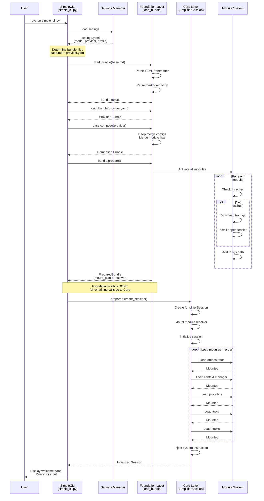

**For non-technical readers**: This is like starting a car:
1. **Load settings**: Check your preferences (which model to use)
2. **Load bundles**: Load the instruction manual (base.md + provider.yaml)
3. **Compose bundles**: Combine the instructions
4. **Prepare modules**: Install all the tools you'll need
5. **Create session**: Start the engine
6. **Initialize**: Connect all the parts
7. **Ready**: Green light - ready to drive!

---

## Bundle System Deep Dive

### What is a Bundle?

A **bundle** is a file (usually `.md` with YAML frontmatter) that describes:
- What modules to use (orchestrator, context, providers, tools, hooks)
- Configuration for each module
- System instructions (the markdown body)
- Resources (context files, agent definitions)

### Bundle Structure

```yaml
---
bundle:
  name: base
  version: 1.0.0
  description: Base bundle with core tools

session:
  orchestrator:
    module: loop-streaming
    source: git+https://github.com/microsoft/amplifier-module-loop-streaming@main
    config:
      extended_thinking: true
      max_iterations: 25
  context:
    module: context-simple
    source: git+https://github.com/microsoft/amplifier-module-context-simple@main

tools:
  - module: tool-filesystem
    source: git+https://github.com/microsoft/amplifier-module-tool-filesystem@main
  - module: tool-bash
    source: git+https://github.com/microsoft/amplifier-module-tool-bash@main

hooks:
  - module: hooks-streaming-ui
    source: git+https://github.com/microsoft/amplifier-module-hooks-streaming-ui@main
---

You are an AI assistant powered by Amplifier...
```

### Bundle Composition Flow

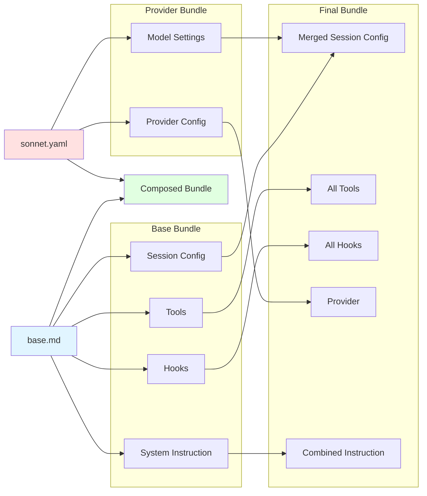

### How Bundle Composition Works

When you compose bundles with `base.compose(provider)`:

1. **Session config**: Deep merge (later overrides earlier)
   - `max_iterations` from provider overrides base

2. **Module lists** (providers/tools/hooks): Merge by module ID
   - If same module ID appears in both, later config wins
   - Different modules are concatenated

3. **Instructions**: Later replaces earlier
   - Provider instruction replaces base instruction

4. **Context files**: Accumulated with namespace prefixes
   - `base:file.md` and `provider:config.yaml` both available

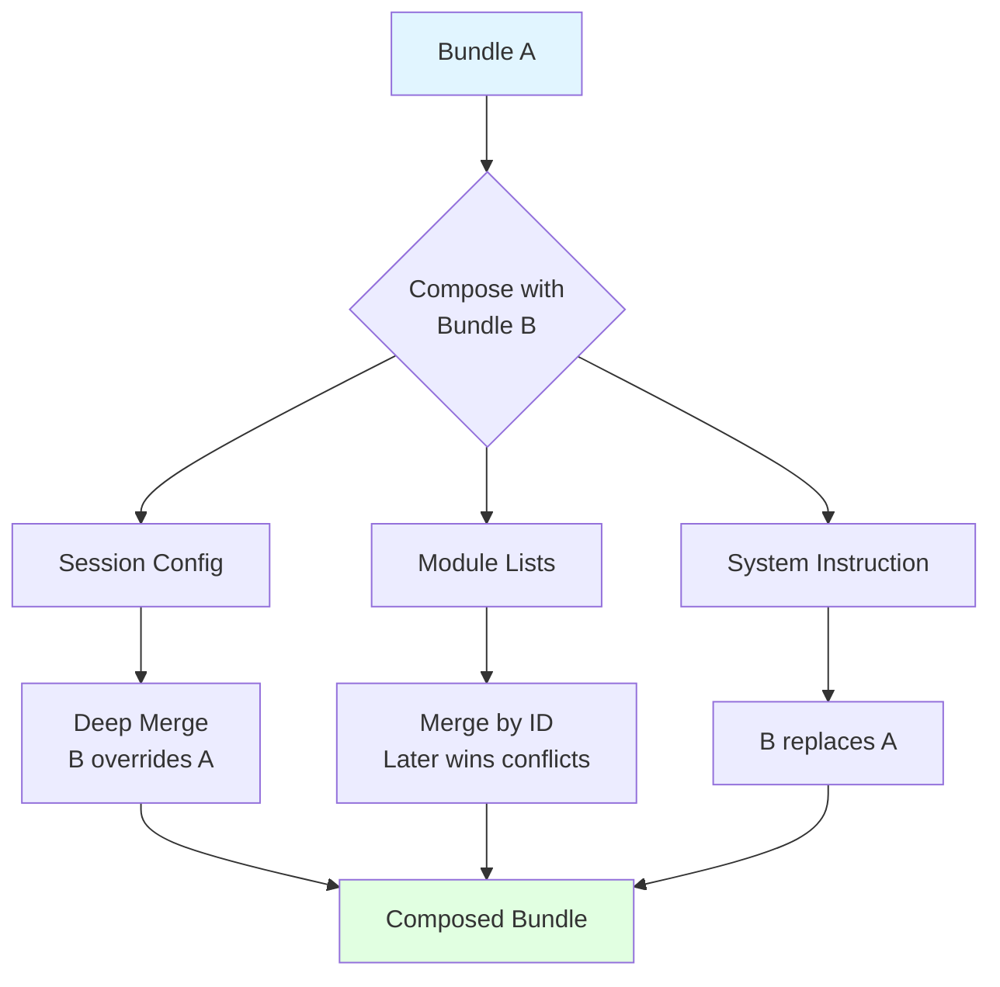

---

## Session Management

### Session Lifecycle

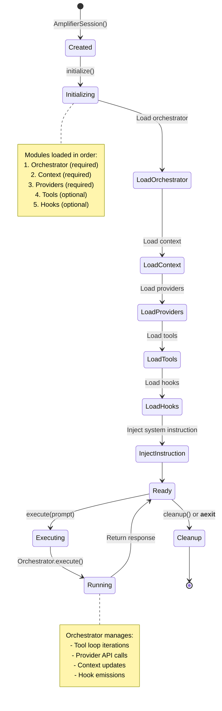

### Session Creation Details

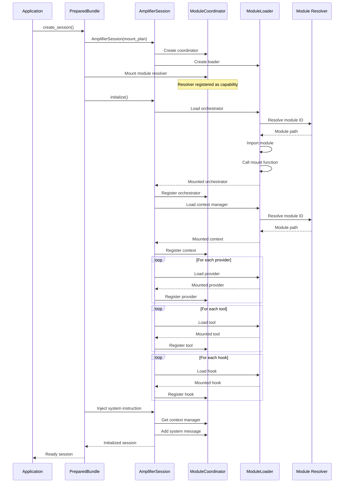

---

## Module System

### What is a Module?

A **module** is a Python package that provides a specific capability:
- **Orchestrator**: Controls the execution loop
- **Context Manager**: Manages conversation history
- **Provider**: Connects to an AI API (Claude, GPT, etc.)
- **Tool**: Gives AI capabilities (read files, run commands, etc.)
- **Hook**: Intercepts events (logging, UI, safety checks)

### Module Structure

Each module has:
1. **Entry point**: A `mount()` function
2. **Configuration**: Defined by module
3. **Source**: Git repo, local file, or Python package

Example module structure:
```python
# amplifier-module-tool-bash/mount.py

async def mount(coordinator, config):
    """Mount function - required entry point."""

    # Register the tool
    tool = BashTool(config)
    coordinator.register("tools", "bash", tool)

    # Return cleanup function
    async def cleanup():
        # Clean up resources
        pass

    return cleanup
```

### Module Activation Flow

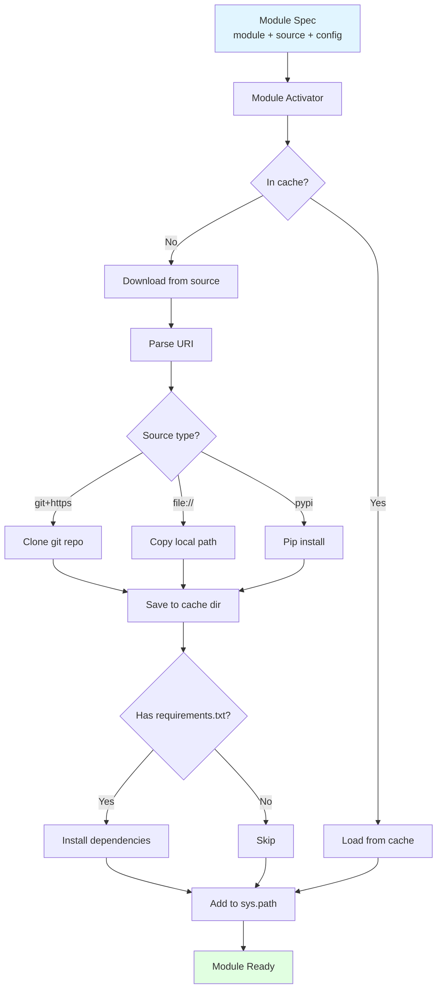

### Module Loading Process

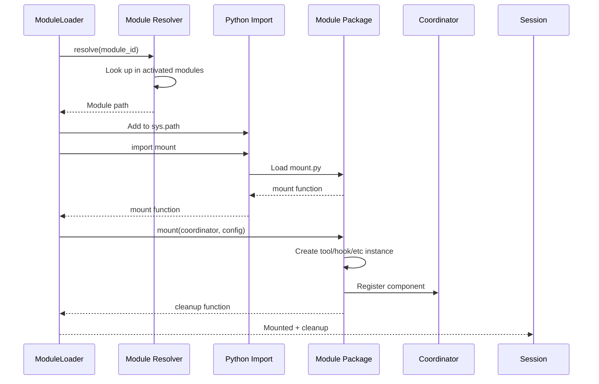

---

## Execution Flow

### The Main Loop

When you type a message and press Enter, here's what happens:

**IMPORTANT**: Foundation is NOT involved in execution. SimpleCLI calls `session.execute()` directly on the Core's AmplifierSession object.

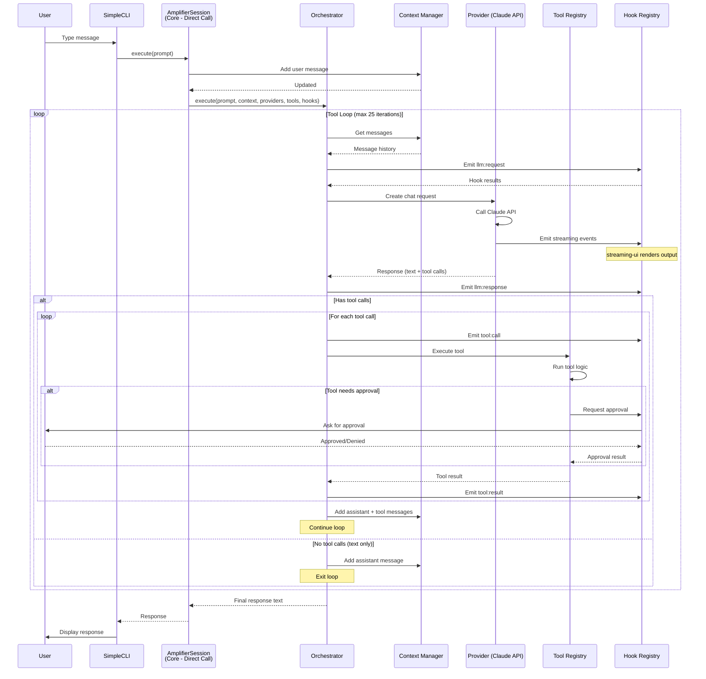

**For non-technical readers**: This is like a conversation with someone who can:
1. **Listen**: Receive your message
2. **Think**: Process through AI (Claude)
3. **Act**: Use tools if needed (read files, run commands)
4. **Check**: Safety hooks verify actions are safe
5. **Respond**: Give you the answer
6. **Repeat**: If more tools needed, go back to step 2

### Tool Execution Detail

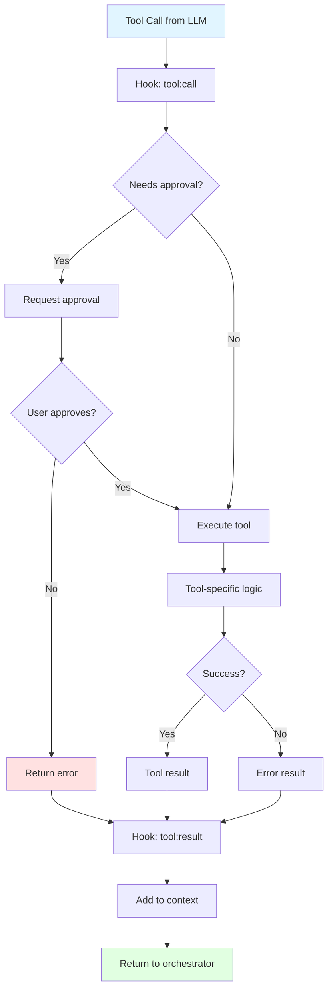

---

## Hook System

### What are Hooks?

**Hooks** are modules that intercept events throughout the execution flow. They allow you to:
- Log events
- Modify data
- Display UI
- Enforce safety policies
- Capture metrics

Think of hooks like "listeners" that can see and react to everything that happens.

### Hook Event Flow

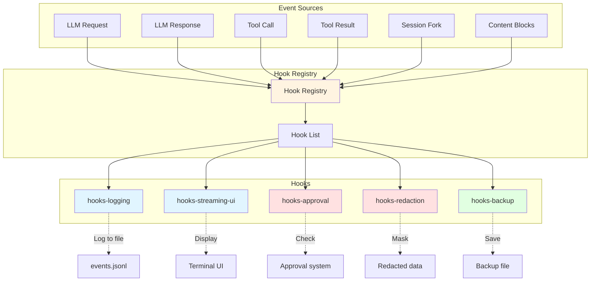

### Hook Execution Sequence

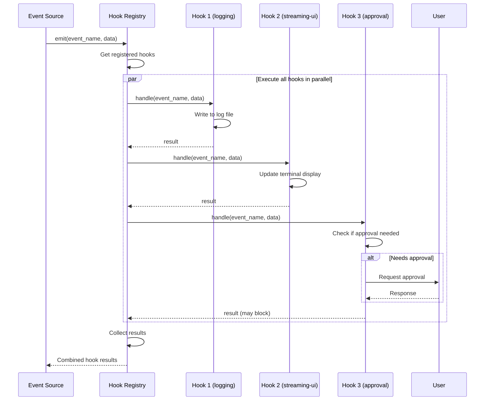

### Common Hook Types

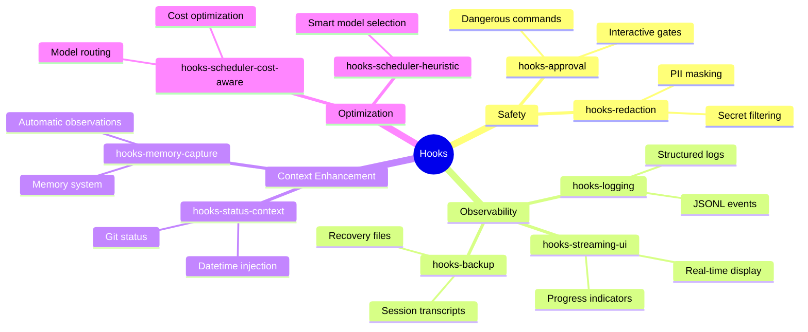

---

## Complete End-to-End Flow

This is the **complete journey** from when you start the application to when you get a response:

```mermaid
flowchart TD
    Start([User runs:<br/>python simple_cli.py]) --> LoadSettings[Load Settings<br/>~/.amplifier-cli/settings.yaml]

    LoadSettings --> CheckAPI{API key set?}
    CheckAPI -->|No| Error1[Display error<br/>Exit]
    CheckAPI -->|Yes| DetermineBundles[Determine Bundles<br/>base.md + provider.yaml]

    DetermineBundles --> LoadBase[Load base.md]
    LoadBase --> ParseYAML1[Parse YAML frontmatter]
    ParseYAML1 --> ParseMD1[Parse markdown body]
    ParseMD1 --> BaseBundle[Base Bundle object]

    BaseBundle --> LoadProvider[Load provider.yaml]
    LoadProvider --> ParseYAML2[Parse provider YAML]
    ParseYAML2 --> ProviderBundle[Provider Bundle object]

    ProviderBundle --> Compose[Compose Bundles<br/>base.compose(provider)]
    Compose --> ComposedBundle[Composed Bundle]

    ComposedBundle --> Prepare[Bundle.prepare()]

    Prepare --> CollectModules[Collect all module specs]
    CollectModules --> LoopModules{For each module}

    LoopModules --> CheckCache{In cache?}
    CheckCache -->|Yes| AddPath[Add to sys.path]
    CheckCache -->|No| Download[Download from git]
    Download --> InstallDeps[Install dependencies]
    InstallDeps --> SaveCache[Save to cache]
    SaveCache --> AddPath

    AddPath --> NextModule{More modules?}
    NextModule -->|Yes| LoopModules
    NextModule -->|No| PreparedBundle[PreparedBundle<br/>mount_plan + resolver]

    PreparedBundle --> FoundationDone["🎯 FOUNDATION COMPLETE<br/>Handoff to Core"]
    FoundationDone --> CreateSession[Create Session<br/>AmplifierSession<br/>CORE DIRECT CALL]
    CreateSession --> MountResolver[Mount module resolver]
    MountResolver --> Initialize[Initialize session]

    Initialize --> LoadOrch[Load orchestrator module]
    LoadOrch --> LoadContext[Load context module]
    LoadContext --> LoadProviders[Load provider modules]
    LoadProviders --> LoadTools[Load tool modules]
    LoadTools --> LoadHooks[Load hook modules]
    LoadHooks --> InjectSysPrompt[Inject system instruction]

    InjectSysPrompt --> SessionReady[Session Ready]
    SessionReady --> DisplayWelcome[Display welcome panel]
    DisplayWelcome --> WaitInput[Wait for user input]

    WaitInput --> UserInput{User types}
    UserInput -->|exit/quit| Cleanup[Cleanup session<br/>Display summary<br/>Exit]
    UserInput -->|sessions| ListSessions[List all sessions]
    ListSessions --> WaitInput
    UserInput -->|message| Execute["⚡ Session.execute(prompt)<br/>CORE DIRECT CALL"]

    Execute --> AddUserMsg[Add user message to context]
    AddUserMsg --> StartLoop[Start orchestrator loop]

    StartLoop --> GetContext[Get conversation history]
    GetContext --> EmitRequest[Emit llm:request hook]
    EmitRequest --> CallProvider[Call provider API]

    CallProvider --> StreamResponse[Stream response<br/>Emit streaming hooks]
    StreamResponse --> GotResponse[Got response]

    GotResponse --> HasTools{Has tool calls?}
    HasTools -->|Yes| EmitToolCall[Emit tool:call hook]
    EmitToolCall --> CheckApproval{Needs approval?}
    CheckApproval -->|Yes| AskApproval[Ask user approval]
    AskApproval --> Approved{Approved?}
    Approved -->|No| ToolError[Return error]
    Approved -->|Yes| ExecuteTool[Execute tool]
    CheckApproval -->|No| ExecuteTool

    ExecuteTool --> EmitToolResult[Emit tool:result hook]
    EmitToolResult --> AddToolMsgs[Add tool messages<br/>to context]
    AddToolMsgs --> CheckIter{Iteration < 25?}
    CheckIter -->|Yes| GetContext
    CheckIter -->|No| MaxIter[Max iterations reached]
    MaxIter --> ReturnResponse

    ToolError --> AddToolMsgs

    HasTools -->|No| AddAssistantMsg[Add assistant message<br/>to context]
    AddAssistantMsg --> ReturnResponse[Return final response]

    ReturnResponse --> DisplayResponse[Display response<br/>in terminal]
    DisplayResponse --> WaitInput

    Cleanup --> End([Exit])

    style Start fill:#e1f5ff
    style LoadBase fill:#fff4e1
    style LoadProvider fill:#fff4e1
    style Compose fill:#fff4e1
    style Prepare fill:#fff4e1
    style PreparedBundle fill:#fff4e1
    style FoundationDone fill:#ffe1e1
    style CreateSession fill:#ffe1f5
    style SessionReady fill:#e1ffe1
    style Execute fill:#ffe1f5
    style DisplayResponse fill:#e1ffe1
    style End fill:#ffe1e1
```

**Color Key**:
- 🔵 **Blue** (Start): Application startup
- 🟡 **Yellow** (LoadBase → PreparedBundle): Foundation setup phase
- 🔴 **Red** (FoundationDone): Foundation → Core handoff
- 🟣 **Purple** (CreateSession, Execute): Core runtime phase
- 🟢 **Green** (SessionReady, DisplayResponse): Ready states

**For non-technical readers - Step by Step**:

1. **Startup (Blue)**: Load your preferences and configuration files
2. **Foundation Setup (Yellow)**: Download and install all the tools needed - the "factory" builds your AI system
3. **Handoff (Red)**: Foundation hands you a fully configured Core session and gets out of the way
4. **Core Initialize (Purple)**: Core connects all the pieces together
5. **Ready (Green)**: Show welcome message, ready for your input
6. **Execution Loop (Purple)**:
   - You type a message → **Direct call to Core** (Foundation not involved)
   - AI processes it through Core
   - AI might need tools (read files, run commands)
   - Safety checks happen
   - You get a response
   - Loop back to waiting for your next message
7. **Exit (Red)**: Clean up and show summary when you quit

**Key Insight**: After step 3, Foundation is completely done. All execution (step 6) goes directly to Core.

---

## Key Design Principles

### 1. **Composability**

Everything is designed to be composable - you can mix and match:
- Different bundles
- Different providers (Claude, GPT, local models)
- Different tools
- Different hooks

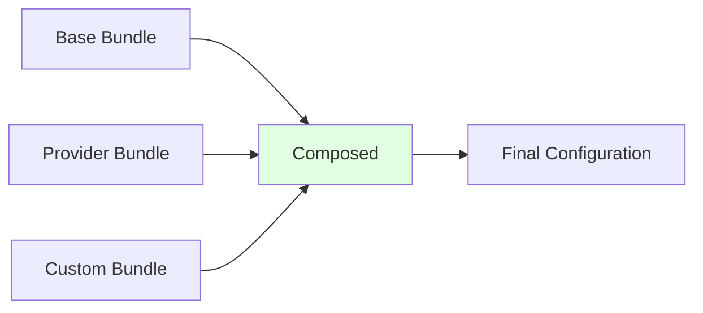

### 2. **Separation of Concerns**

Three clear layers:
- **Application**: User interface and interaction
- **Foundation**: Configuration and composition
- **Core**: Execution engine

Each layer has a single responsibility and clean interfaces.

### 3. **Modularity**

Every capability is a module:
- Easy to add new modules
- Easy to remove modules
- Easy to swap modules
- Modules don't know about each other

### 4. **Event-Driven Architecture**

Hooks provide event-driven capabilities:
- Any part can listen to events
- No tight coupling between components
- Easy to add new behaviors without modifying existing code

### 5. **Safety First**

Multiple safety layers:
- Approval hooks for dangerous operations
- Redaction hooks for sensitive data
- Backup hooks for session recovery
- Iteration limits prevent infinite loops

---

## Data Flow Diagram

**Phase 1: Setup (Foundation)** → **Phase 2: Runtime (Core)**

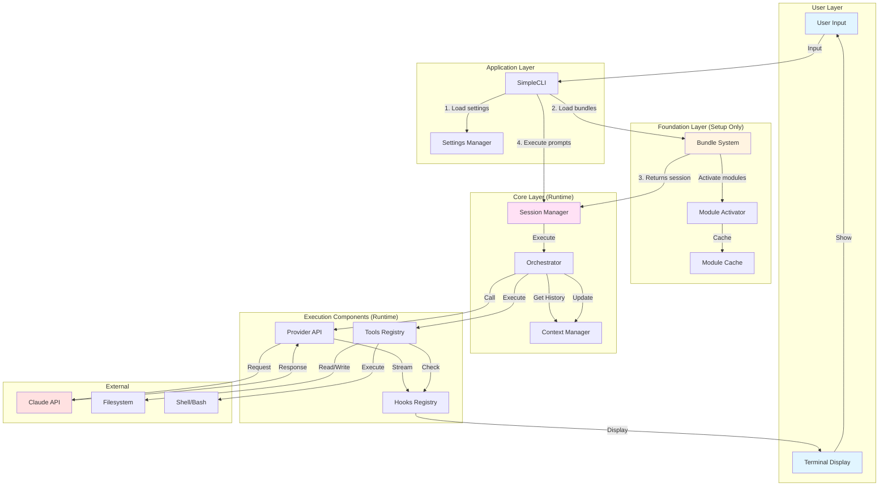

**Key Insight**: Foundation (yellow) is only used during steps 1-3 (setup). After that, SimpleCLI calls Core (purple) directly for all execution (step 4 onwards).

---

## File Structure

```
amplifier-simplecli/
├── simple_cli.py              # Main entry point
├── module_registry.py         # Module catalog/manager
├── assets/
│   ├── bundles/
│   │   └── base.md           # Base bundle definition
│   └── providers/
│       ├── opus.yaml         # Opus provider config
│       ├── sonnet.yaml       # Sonnet provider config
│       └── haiku.yaml        # Haiku provider config
├── hooks/
│   └── hooks_debug/          # Custom debug hook
└── .venv/lib/python3.13/site-packages/
    ├── amplifier_foundation/  # Foundation layer
    │   ├── bundle.py         # Bundle class
    │   ├── registry.py       # Bundle registry
    │   ├── modules/
    │   │   └── activator.py  # Module activator
    │   └── sources/
    │       └── resolver.py   # URI resolver
    └── amplifier_core/        # Core layer
        ├── session.py         # AmplifierSession
        ├── coordinator.py     # ModuleCoordinator
        ├── loader.py          # ModuleLoader
        └── hooks.py           # Hook registry

~/.amplifier/                  # User data directory
├── cache/                     # Cached bundles
├── module-cache/              # Cached modules
├── modules/                   # Downloaded modules
└── projects/                  # Project sessions
    └── {project-id}/
        └── sessions/
            └── {session-id}/
                └── events.jsonl  # Session events

~/.amplifier-cli/              # SimpleCLI settings
└── settings.yaml              # User settings
```

---

## Configuration Files

### settings.yaml (~/.amplifier-cli/settings.yaml)

```yaml
model: claude-sonnet-4-5
api_key_env: ANTHROPIC_API_KEY
provider: anthropic
profile: dev
base_url: https://api.anthropic.com
```

### base.md (assets/bundles/base.md)

See [Bundle Structure](#bundle-structure) section above.

### Provider YAML (assets/providers/sonnet.yaml)

```yaml
bundle:
  name: provider-anthropic-sonnet
  version: 1.0.0

providers:
  - module: provider-anthropic
    source: git+https://github.com/microsoft/amplifier-module-provider-anthropic@main
    config:
      default_model: claude-sonnet-4-5
      max_iterations: 25
      timeout: 120
```

---

## Glossary

### Key Terms

- **Bundle**: A composable configuration unit containing module specifications and instructions
- **Module**: A Python package providing a specific capability (orchestrator, tool, provider, hook)
- **Mount Plan**: The final composed configuration passed to AmplifierSession
- **Orchestrator**: The module that controls the execution loop
- **Context Manager**: The module that manages conversation history
- **Provider**: The module that connects to an AI API (Claude, GPT, etc.)
- **Tool**: A capability the AI can use (read files, run commands, etc.)
- **Hook**: An event interceptor that can observe or modify execution
- **Session**: A single conversation with the AI
- **Coordinator**: The registry that manages all mounted components
- **Resolver**: A system that maps module IDs to local paths

---

## Summary

SimpleCLI is a three-layer architecture for AI conversations:

1. **Application Layer** (simple_cli.py): User interface and interaction
2. **Foundation Layer** (amplifier-foundation): Configuration and composition system
3. **Core Layer** (amplifier-core): Execution engine

The flow is:
1. Load settings and bundles
2. Compose bundles into final configuration
3. Activate (download/install) all modules
4. Create and initialize session
5. Execute prompts through orchestrator loop
6. Display responses to user

Key features:
- **Composable**: Mix and match bundles
- **Modular**: Easy to add/remove capabilities
- **Safe**: Multiple safety layers
- **Extensible**: Hook system for custom behavior
- **Cached**: Downloaded modules are cached for speed

This architecture provides a flexible, powerful system for AI conversations with tool use, safety features, and extensibility.

---

**Generated**: 2025-12-21
**Version**: 1.0
**For**: Amplifier SimpleCLI Project
